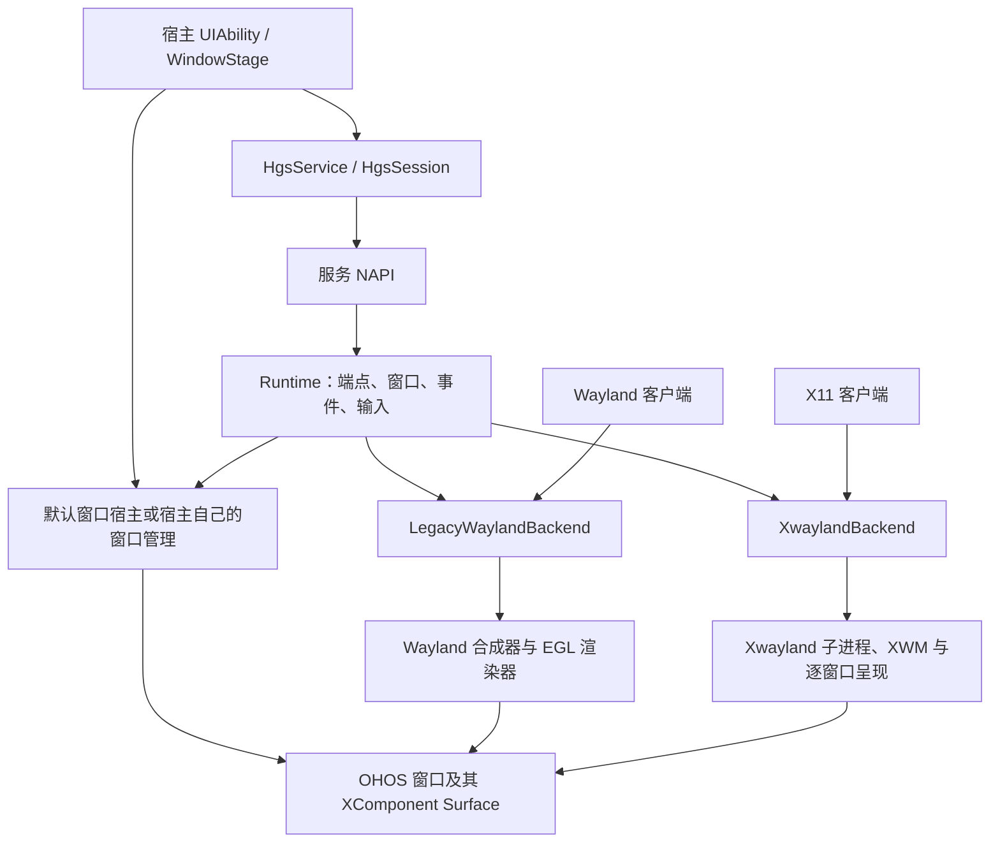

# HGS 技术架构

HGS 是嵌入 HarmonyOS 应用的 HAR。宿主在应用进程内启动图形服务，选择监听 Wayland、X11 或两种协议。客户端通过对应的协议连接，提交窗口和内容。HGS 把客户端窗口绑定到 OHOS Surface，并将窗口操作和输入送回客户端。终端、Wine 引擎或其他客户端的启动、环境和退出策略由宿主应用负责。

## 服务如何接到窗口

一次完整接入分为四步：

1. **启动监听。** ArkTS 的 `HgsService.start()` 经异步 NAPI 调用进程内的 Runtime。Runtime 校验配置和编译能力，为本次启动分配 `epoch`。所有选中的后端都发布可用端点和逻辑输出后，服务才进入 ready。启动不需要提前创建 OHOS 窗口。
2. **启动客户端。** 宿主用 `session.clientEnvironment(protocol)` 取得实际端点所需的环境，合并 `set`、删除 `unset` 中的变量，再交给对应客户端。Wayland 端点由运行目录和 socket 名组成；X11 端点包含分配的 display 和认证文件。两种协议同时监听时，应为各客户端分别构造环境。
3. **创建承载窗并绑定 Surface。** 协议端观察到客户端窗口后，窗口管理层取得窗口身份。默认宿主创建 OHOS 窗口并加载对应的 ArkUI 页面，页面内的 XComponent 负责 Surface 绑定。收到窗口事件、Surface 就绪和首帧呈现是不同阶段。
4. **回传输入和窗口操作。** 触摸、鼠标、键盘及 OHOS 窗口焦点回到对应后端。公共窗口控制可请求聚焦、失焦、改尺寸和关闭。关闭请求发给客户端，实际销毁由协议事件确认。客户端全部退出后服务继续监听，直至宿主显式停止。

## Wayland 路径

`LegacyWaylandBackend` 将原有 `HgsInstance` 和 `WaylandServer` 接到统一服务。Unix 监听由 HGS 按指定目录和名称创建，Wayland 事件循环处理客户端连接、surface 提交和 xdg-shell 窗口状态。帧合成、弹窗及顶层关系仍由原有 `compositor/` 实现，`graphics/` 的 EGL 渲染器把内容输出到承载 Surface。

默认宿主通过 `HgsWindowHostService` 消费 Wayland 窗口事件，每个顶层窗口有一个 multiton `HgsAppWindowAbility` 实例。Ability 加载 `HgsWindowPage`，页面中的 `HgsSurface` 绑定 Wayland 的数值窗口 ID，并按默认配置使用原生输入。公共服务另有字符串窗口 ID，快照中的 `legacyId` 用于与这条既有路径对接。Wayland popup 仍按父窗口事件处理。

## X11 路径

`XwaylandBackend` 负责 X11 端点和会话线程。后端分配本地 abstract Unix socket，生成 Xauthority 和本次会话的键盘缓存，启动 Xwayland 原生子进程，并等待逻辑输出和 XWM 就绪。X11 客户端连到 Xwayland，HGS 内的 wlroots 会话观察顶层窗口、弹窗、几何和输入焦点。

默认的 `HgsServiceWindowHost` 在传入的 WindowStage 下创建子窗口，通过 `HgsServiceWindowPage` 和 `HgsWindowSurface` 绑定窗口 ID 与 epoch。Surface 绑定后的 `framePresented` 表示当前绑定已经提交首帧。常规呈现把 CPU 可读缓冲转换后写到 OHOS Surface；原生宿主也可在启动前注册可选的 `ExternalFrameProvider`，按 XID、客户端 PID 和窗口代次接入 GPU 帧。XIM 是单独的可选构建能力，启用后可将确认的文本提交给有输入焦点的 X11 窗口。

## 两条协议共享的规则

| 职责 | 实现 |
| --- | --- |
| 服务生命周期 | `runtime/service_runtime.cpp` 串行管理启停、配置冲突及失败回滚。同配置重复启动返回原会话。切换协议或其他启动配置时，先停止，再启动。 |
| 窗口身份 | `core/window_registry.*` 维护协议、后端、连接、原生对象和对象代次。公共 ID 是不透明字符串，宿主在处理旧窗口或迟到事件前校验 epoch。 |
| 事件分发 | `core/event_bus.*` 与 Runtime 维护订阅和事件顺序。原生后端线程产生的事件通过 NAPI 的线程安全函数交给 ArkTS。原生订阅回调里的启停请求应投递到控制线程。 |
| 输入路由 | `core/input_router.*` 根据公共 ID 找后端，维护按下与释放的归属。窗口销毁或焦点切换时清理相应状态。 |

`both` 下两个端点有各自的逻辑输出和协议事件循环。默认窗口宿主使用逐窗口模式，X11 不支持 `desktop-root`，因此两种协议也不会共享一张桌面画布。跨协议剪贴板和拖放尚未实现。若运行中的 Xwayland 退出，服务撤销该端点并发出 `backend-disconnected`，仍就绪的 Wayland 端点可以继续服务。宿主需要重新检查当前快照，再决定是否重启整个会话。

下一步可看[目录结构](repository-layout.md)、[新项目接入指引](../integration/new-project.md)和[公共服务 API](../api/service-api.md)。
